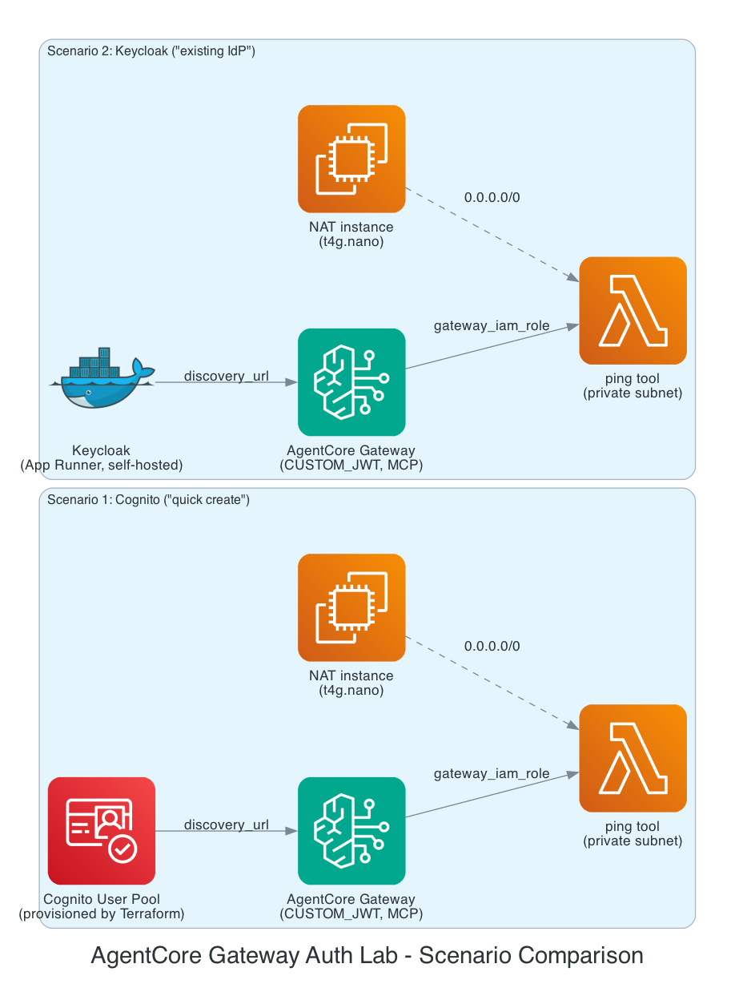

# Bedrock AgentCore Gateway configuration lab

A dedicated lab for exercising different **AgentCore Gateway**
configurations in isolation, one scenario per sub-directory - distinct
from [`bedrock-agentcore-lab`](../bedrock-agentcore-lab/), which exercises
the full Gateway+Runtime+Identity+Policies pipeline once, with a single
Gateway configuration (`AWS_IAM`).

## Sub-labs

### Inbound auth

Mirrors the two paths on the AWS console's own Gateway creation screen for
inbound auth (see the console's "Inbound Auth configurations" panel):

| Scenario | Path | Identity provider |
|---|---|---|
| [inbound-auth-scenario-1-cognito](inbound-auth-scenario-1-cognito/) | "Quick create configurations with Cognito" | Cognito User Pool, provisioned by this stack |
| [inbound-auth-scenario-2-keycloak](inbound-auth-scenario-2-keycloak/) | "Use existing Identity provider configurations" | Keycloak, self-hosted by this stack on App Runner |

Each scenario is a fully independent OpenTofu stack (own VPC, own NAT
instance, own state) - **no shared state between them**, matching this
repo's usual convention. That also means deploying both at once doubles
the NAT instance cost; see each scenario's own README for exact numbers.
Scenario 2 is significantly more involved (and costly) than scenario 1 -
read its README's risk section before running it.

### Outbound auth (not built yet)

A natural next sub-lab: AgentCore's outbound credential providers (API
key, OAuth2) for Gateway targets that call real third-party APIs, as
opposed to this repo's existing demos which only invoke Lambda tools
within the same account.

### Private Gateway access

A different axis entirely - not IdP choice, but *network* reachability.
Prompted by a real question after applying scenario 1 live: its Gateway
endpoint is public - can that be locked down?

| Scenario | Demonstrates |
|---|---|
| [private-access-scenario-3-aws-iam](private-access-scenario-3-aws-iam/) | `authorizer_type = AWS_IAM` + a Gateway PrivateLink interface endpoint + an `aws:SourceVpce`-conditioned IAM role, so one specific identity can only call the Gateway from inside the VPC. Confirmed from AWS's own docs: this lockdown is **not possible** for `CUSTOM_JWT` gateways (scenarios 1/2) - their endpoint policy is forced to `Principal: "*"` since OAuth callers have no IAM identity to restrict. Read that scenario's "what this does and doesn't prove" section before assuming more than it demonstrates.

## Conventions

Same as the rest of this repo (see the root README): OpenTofu preferred,
`<topic>-lab/` naming, `force_destroy`/cost-conscious defaults where
possible. This lab family's scenarios are an exception to the "no NAT"
convention for the same reason `bedrock-agentcore-lab` is - see that lab's
README for the rationale, which applies here too.
