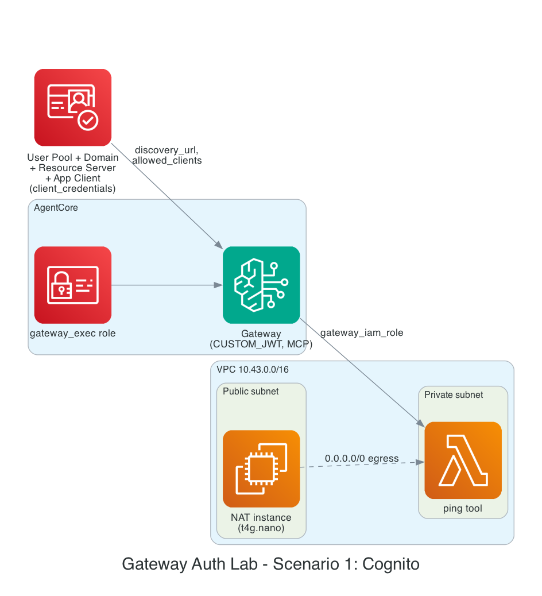

# Gateway auth lab - Scenario 1: Cognito "quick create"

Mirrors the AWS console's AgentCore Gateway creation screen's **"Quick
create configurations with Cognito"** path: the Gateway's inbound auth is
`CUSTOM_JWT`, backed by a Cognito User Pool Terraform creates for you, not
one you already run. Compare with
[scenario 2](../inbound-auth-scenario-2-keycloak/), which uses an
**existing** identity provider (Keycloak) instead.

```
Cognito User Pool + Domain + Resource Server (scope: tools/invoke)
  + App Client (client_credentials, confidential)
         |
         v  discovery_url
AgentCore Gateway (authorizer_type = CUSTOM_JWT, MCP)
         |
         v  gateway_iam_role passthrough
Gateway Target -> ping Lambda (private subnet)

Non-default VPC (10.43.0.0/16), 2 AZs, t4g.nano NAT instance for the
Lambda's egress - same pattern as bedrock-agentcore-lab, see that lab's
README for why a NAT instance instead of a NAT Gateway.
```



## Prerequisites

1. OpenTofu >= 1.6 and the AWS CLI configured with credentials that can
   create VPCs, EC2, IAM, Lambda, Cognito, and Bedrock AgentCore resources
   (`AWS_PROFILE=dops` throughout development).
2. A region where Bedrock AgentCore is available (default here is
   `us-east-1`).

**Confirmed working end to end against a live `apply`** (2026-10-20): the
`bedrock-agentcore.amazonaws.com` trust principal in `gateway.tf` is
correct, `gateway_iam_role` credential passthrough successfully invokes
the `ping` Lambda, and the `CUSTOM_JWT` authorizer correctly rejects
unauthenticated calls (`401`) and accepts a valid Cognito JWT (`200`).
One real surprise worth knowing before you test this yourself: `tools/call`
must address the tool as `ping___ping`
(`<gateway_target_name>___<tool_name>`), not the bare tool name - `scripts/
get_token_and_call_gateway.py` already accounts for this.

Two apply-time bugs were also caught and fixed by a real run: an
`aws_security_group` description can't contain an apostrophe, and a
Cognito user pool domain prefix can't contain the literal word "cognito"
(this lab's own `project_name` did, until `cognito.tf` was patched to swap
it out just for the domain).

## Run it

```bash
tofu init
tofu plan
tofu apply
```

```bash
cd scripts
pip install -r requirements.txt

export TOKEN_ENDPOINT=$(tofu -chdir=.. output -raw token_endpoint)
export APP_CLIENT_ID=$(tofu -chdir=.. output -raw app_client_id)
export APP_CLIENT_SECRET=$(tofu -chdir=.. output -raw app_client_secret)
export SCOPE="$(tofu -chdir=.. output -raw resource_server_identifier)/invoke"
export GATEWAY_URL=$(tofu -chdir=.. output -raw gateway_url)

python3 get_token_and_call_gateway.py
```

You should see step 1 (no token) rejected, then steps 2-4 succeed once a
real Cognito-issued JWT is attached.

## Cost notes

Same standing cost shape as `bedrock-agentcore-lab`: the NAT instance and
its public IP bill continuously while deployed.

| Component | Est. cost |
|---|---|
| NAT instance (t4g.nano) | ≈ $3.06/month |
| Public IPv4 (the EIP) | ≈ $3.65/month |
| Cognito User Pool | Free tier covers this volume (MAU-based pricing, 0 actual users here) |
| Lambda, CloudWatch Logs | ~$0 |
| AgentCore Gateway | Newer service, consumption-based - check [Bedrock pricing](https://aws.amazon.com/bedrock/pricing/) |

**≈ $6.71/month standing cost while deployed** - don't leave this running
between sessions.

## Clean up

```bash
tofu destroy
```
