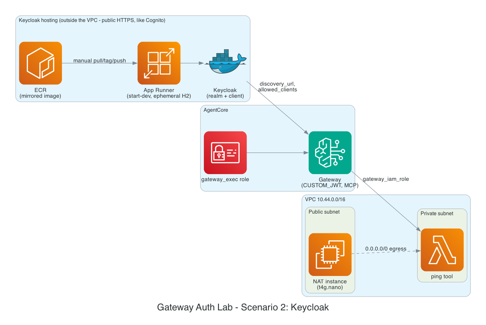

# Gateway auth lab - Scenario 2: existing Identity provider (Keycloak)

Mirrors the AWS console's AgentCore Gateway creation screen's **"Use
existing Identity provider configurations"** path. Unlike
[scenario 1](../inbound-auth-scenario-1-cognito/) (where Cognito is
provisioned fresh), the point here is a Gateway pointed at an IdP that
already exists - this lab stands up a real Keycloak instance to play that
role, rather than assuming you have one lying around.

```
ECR repo (you mirror the public Keycloak image into it - step 1 below)
         |
         v
App Runner service (public HTTPS, auto-assigned *.awsapprunner.com URL,
   start-dev mode, EPHEMERAL H2 storage - see "Ephemeral storage" below)
         |
         v  (once healthy - three-phase apply, see "Run it")
keycloak Terraform provider -> realm + confidential client
   (service_accounts_enabled, client_credentials grant)
         |
         v  discovery_url
AgentCore Gateway (authorizer_type = CUSTOM_JWT, MCP)
         |
         v  gateway_iam_role passthrough
Gateway Target -> ping Lambda (private subnet)

Non-default VPC (10.44.0.0/16), 2 AZs, t4g.nano NAT instance for the
Lambda's egress - same pattern as bedrock-agentcore-lab and scenario 1.
Keycloak itself runs on App Runner, outside this VPC - identity providers
are conventionally external services, same as Cognito is in scenario 1.
```



## This is the riskiest stack in the repo - read this first

`bedrock-agentcore-lab`'s remaining "unverified" items apply here too
(IAM action names beyond the trust principal). The
`bedrock-agentcore.amazonaws.com` trust principal + `gateway_iam_role`
passthrough itself **is** confirmed working (scenario 1's Cognito stack
was applied and tested live), and the `tools/call` naming quirk scenario
1 found (`<gateway_target_name>___<tool_name>`, e.g. `ping___ping` -
already baked into this scenario's `scripts/get_token_and_call_gateway.py`)
should carry over too, since it's Gateway behavior, not IdP-specific.
**Plus**, this scenario adds real, new, untested surface:

- **Keycloak-behind-App-Runner hostname behavior.** `apprunner.tf` sets
  `KC_HOSTNAME_STRICT = "false"` as a workaround for not knowing the
  App Runner URL at image-build time. Whether this actually produces a
  discovery document AgentCore's `CUSTOM_JWT` authorizer accepts hasn't
  been tested against a live `apply`.
- **Three-phase apply timing.** Keycloak's admin API (needed by the
  `keycloak` Terraform provider) becomes reachable some unknown number of
  seconds after App Runner reports the service healthy. "Run it" below
  has you wait and retry rather than guessing a sleep duration.
- **Ephemeral storage.** `start-dev` mode uses an in-memory/embedded H2
  database. Any App Runner redeploy, auto-scaling event, or restart wipes
  the realm and client - **independently of Terraform state**, which will
  still think they exist. If `keycloak_*` resources start failing with
  "not found" errors after the stack has been up a while, this is why -
  `tofu apply` again to recreate them (same effort as a normal lab
  "run it" step, just a sharper edge than usual).

## Prerequisites

1. OpenTofu >= 1.6, AWS CLI (`AWS_PROFILE=dops`), and **Docker** (to mirror
   the Keycloak image - no build step, just a pull/tag/push).
2. A region where Bedrock AgentCore is available (default `us-east-1`).

Validated with `tofu validate` and a real, `-target`-scoped `tofu plan`
(36 resources, 0 errors) against the `dops` account, confirming both that
the `keycloak/keycloak` provider installs cleanly from OpenTofu's registry
and that the `-target` list in "Run it" actually avoids the provider's
eager-login crash. **Not** validated with a full `apply` (see the risk
section above for exactly what that leaves unverified).

## Run it

Phases 1 and 2 below must pass `-target` flags that exclude everything
behind the `keycloak` provider (`keycloak_realm`, `keycloak_openid_client`).
This isn't optional stylistic caution: the `keycloak` provider logs in
during its own `configure` step, and its `url` is built from
`aws_apprunner_service.keycloak.service_url` - which doesn't exist on the
first two applies. Without `-target`, `tofu plan`/`apply` fails outright
with `failed to perform initial login to Keycloak: ... unsupported
protocol scheme ""` (confirmed during development - this isn't
theoretical). Define the target list once:

```bash
TARGETS=(
  -target=aws_vpc.this -target=aws_subnet.public -target=aws_subnet.private
  -target=aws_internet_gateway.this -target=aws_route_table.public -target=aws_route_table.private
  -target=aws_route_table_association.public -target=aws_route_table_association.private
  -target=aws_security_group.nat_instance -target=aws_security_group.private_compute
  -target=aws_instance.nat -target=aws_eip.nat -target=aws_iam_role.nat_instance
  -target=aws_iam_role_policy_attachment.nat_instance_ssm -target=aws_iam_instance_profile.nat_instance
  -target=aws_ecr_repository.keycloak -target=aws_ecr_lifecycle_policy.keycloak
  -target=aws_iam_role.apprunner_ecr_access -target=aws_iam_role_policy_attachment.apprunner_ecr_access
  -target=aws_ssm_parameter.keycloak_admin_password -target=aws_iam_role.apprunner_instance
  -target=aws_iam_role_policy.apprunner_instance_read_admin_password -target=aws_apprunner_service.keycloak
  -target=aws_lambda_function.ping -target=aws_iam_role.ping_exec -target=aws_iam_role_policy_attachment.ping_basic_logs
  -target=aws_iam_role_policy_attachment.ping_vpc_access -target=aws_cloudwatch_log_group.ping
  -target=aws_iam_role.gateway_exec -target=aws_iam_role_policy.gateway_invoke_ping_lambda
  -target=aws_bedrockagentcore_gateway.tools -target=aws_bedrockagentcore_gateway_target.ping
)
```

(Confirmed during development: `tofu plan "${TARGETS[@]}"` plans all 36
non-Keycloak-provider resources cleanly, with no provider-configure error.)

### 1. Mirror the Keycloak image into this lab's ECR

```bash
tofu init
tofu apply "${TARGETS[@]}"   # VPC/NAT/ECR/IAM + App Runner on a placeholder image tag

docker pull quay.io/keycloak/keycloak:latest
REPO=$(tofu output -raw ecr_repository_url)
aws ecr get-login-password --region us-east-1 --profile dops | docker login --username AWS --password-stdin "${REPO%/*}"
docker tag quay.io/keycloak/keycloak:latest "$REPO:latest"
docker push "$REPO:latest"
```

### 2. Point App Runner at the real image and wait for it to boot

```bash
tofu apply "${TARGETS[@]}" -var="keycloak_image_tag=latest"

# Wait for the service to go RUNNING and actually answer requests -
# Keycloak's JVM startup is slow (expect 30-90s beyond "service healthy"):
until curl -fs "$(tofu output -raw keycloak_url)/realms/master/.well-known/openid-configuration" > /dev/null; do
  echo "waiting for Keycloak..."; sleep 10
done
```

### 3. Create the realm and client

```bash
tofu apply   # NO -target this time - Keycloak is reachable, so the provider's configure step succeeds
```

### 4. Test it

```bash
cd scripts
pip install -r requirements.txt

export TOKEN_ENDPOINT=$(tofu -chdir=.. output -raw token_endpoint)
export CLIENT_ID=$(tofu -chdir=.. output -raw client_id)
export CLIENT_SECRET=$(tofu -chdir=.. output -raw client_secret)
export GATEWAY_URL=$(tofu -chdir=.. output -raw gateway_url)

python3 get_token_and_call_gateway.py
```

## Cost notes

The most expensive lab in this repo - NAT instance **and** App Runner both
bill continuously while deployed.

| Component | Cost driver | Est. cost |
|---|---|---|
| NAT instance (t4g.nano) | Standing | ≈ $3.06/month |
| Public IPv4 (the EIP) | Standing | ≈ $3.65/month |
| App Runner (1 vCPU / 2GB) | Provisioned + active compute - costed as always-on since this lab didn't confirm whether App Runner scales to zero when idle | ≈ $30-50/month if left running continuously - check [App Runner pricing](https://aws.amazon.com/apprunner/pricing/) |
| ECR | One Keycloak image (~300-500MB) | ~$0.03-0.05/month |
| Lambda, CloudWatch, SSM Parameter | Negligible | ~$0 |

**This is not a "leave it running" lab even by this repo's already-loose
standards.** Tear it down right after testing.

## Clean up

```bash
tofu destroy
```
