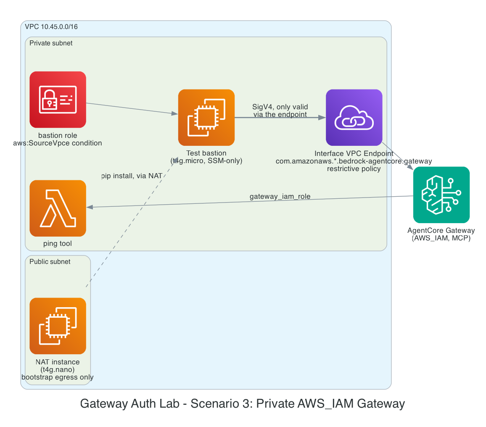

# Gateway auth lab - Scenario 3: private AWS_IAM Gateway (PrivateLink)

Started as a follow-up question after applying [scenario 1](../inbound-auth-scenario-1-cognito/)
live: its Gateway endpoint is reachable from the public internet - can
that be avoided? Research into AWS's own PrivateLink docs for AgentCore
found the real answer is nuanced: a real Interface VPC Endpoint exists for
Gateway ingress, but **AWS's docs state its endpoint policy can only
restrict callers by IAM principal - OAuth/JWT callers (scenarios 1 and 2)
have no IAM principal, so their endpoint policy is forced to `Principal:
"*"`.** True lockdown isn't achievable for a `CUSTOM_JWT` gateway. This
scenario demonstrates the configuration that *does* support it:
`authorizer_type = AWS_IAM`.

```
Bastion EC2 (t4g.micro, private subnet, SSM-only, no public IP)
  IAM role: bedrock-agentcore:InvokeGateway on this gateway's ARN,
            Condition: aws:SourceVpce = this VPC endpoint's id
         |
         v  SigV4 - only valid when it transits the endpoint below
Interface VPC Endpoint (com.amazonaws.<region>.bedrock-agentcore.gateway)
  - restrictive policy: Principal = the bastion's role ARN only
  - security group: 443 inbound from the bastion's SG only
         |
         v
AgentCore Gateway (authorizer_type = AWS_IAM, MCP)
         |
         v  gateway_iam_role passthrough
Gateway Target -> ping Lambda (private subnet) - same tool as scenarios 1/2

Non-default VPC (10.45.0.0/16), 2 AZs, t4g.nano NAT instance - still
needed for the bastion's own bootstrap (pip install boto3/requests) and
the Lambda's general egress, even though the Gateway call itself never
touches it.
```



## What this does and doesn't prove - read this before testing

This demonstrates **least-privilege scoping, not an absolute firewall.**
Anyone holding *unconditioned* `bedrock-agentcore:InvokeGateway`
permissions - including the `dops` SSO admin role used throughout this
project - can still call this Gateway's public endpoint directly from
anywhere. IAM conditions only bind to the specific identity they're
attached to; they don't change what the Gateway itself is reachable from.

What's actually guaranteed: the **bastion's own role**, scoped with
`aws:SourceVpce`, cannot succeed except via the VPC endpoint - exactly the
scoping you'd want for a real workload identity (a Runtime's execution
role, say) that should never need the public internet to reach its own
Gateway. Don't test this expecting "the gateway is now unreachable from
the internet" - test it expecting "this one purpose-built identity only
works from inside the VPC."

## Unverified against live AWS docs

- The Interface VPC Endpoint service name
  (`com.amazonaws.<region>.bedrock-agentcore.gateway`) and the endpoint
  policy's `Principal: "*"`-for-OAuth constraint **are confirmed** - from
  a live fetch of AWS's PrivateLink-for-AgentCore docs page, not inferred.
- The `aws:SourceVpce` condition actually denying a direct public call
  for `bedrock-agentcore:InvokeGateway` specifically is **not confirmed**
  the same way - it's a standard, well-established IAM pattern (used this
  way for S3, KMS, etc.) extended here to a service I haven't
  independently tested it against. `scripts/run_private_test.sh` is how
  you'd confirm it.
- Same trust-principal/action-name caveats as every other lab here - see
  `bedrock-agentcore-lab`'s README for the full list (scenario 1's live
  apply did confirm the trust principal + `gateway_iam_role` passthrough
  work correctly).

## Prerequisites

1. OpenTofu >= 1.6 and the AWS CLI configured with credentials that can
   create VPCs, EC2, IAM, Lambda, VPC endpoints, and Bedrock AgentCore
   resources (`AWS_PROFILE=dops` throughout development).
2. A region where Bedrock AgentCore's Gateway PrivateLink endpoint is
   available (default here is `us-east-1`).
3. The AWS CLI's `ssm` plugin for Session Manager isn't required for
   `scripts/run_private_test.sh` (it uses `send-command`, not an
   interactive session) - but useful to have if you want to poke around
   on the bastion directly: `aws ssm start-session --target <instance-id>`.

Validated with `tofu validate` and a real `tofu plan` against the `dops`
account (36 resources, 0 errors) - not yet with a full `apply`.

## Run it

```bash
tofu init
tofu plan
tofu apply
```

```bash
cd scripts
export AWS_PROFILE=dops
export AWS_REGION=us-east-1
export BASTION_INSTANCE_ID=$(tofu -chdir=.. output -raw bastion_instance_id)

./run_private_test.sh
```

This dispatches the actual SigV4-signed Gateway call to run **on the
bastion** via SSM, not on your laptop - see the honesty section above for
why. You should see `tools/list` and `tools/call ping___ping` both
succeed (`HTTP 200`).

### To see the lockdown actually matter

The interesting test is proving the *same* bastion role fails outside the
VPC path. There's no clean way to demonstrate this without copying the
bastion's temporary credentials off the instance (not recommended, and not
scripted here deliberately) - the honest version of this test is trusting
that the IAM condition evaluates the way AWS documents `aws:SourceVpce`
working for every other SigV4 service, which is exactly the "unverified"
item flagged above.

## Cost notes

Adds a VPC Interface Endpoint and a second EC2 instance on top of the
usual NAT instance - the most standing-cost-heavy of the three scenarios
after Keycloak's App Runner.

| Component | Est. cost |
|---|---|
| NAT instance (t4g.nano) | ≈ $3.07/month |
| Public IPv4 (the NAT's EIP) | ≈ $3.65/month |
| Bastion (t4g.micro) | ≈ $6.13/month |
| Interface VPC Endpoint (2 AZs) | ≈ $14.60/month + $0.01/GB processed (negligible at lab volume) |
| Lambda, CloudWatch Logs | ~$0 |
| AgentCore Gateway | Newer service, consumption-based - check [Bedrock pricing](https://aws.amazon.com/bedrock/pricing/) |

**≈ $27.45/month standing cost while deployed** - don't leave this running
between sessions.

## Clean up

```bash
tofu destroy
```
